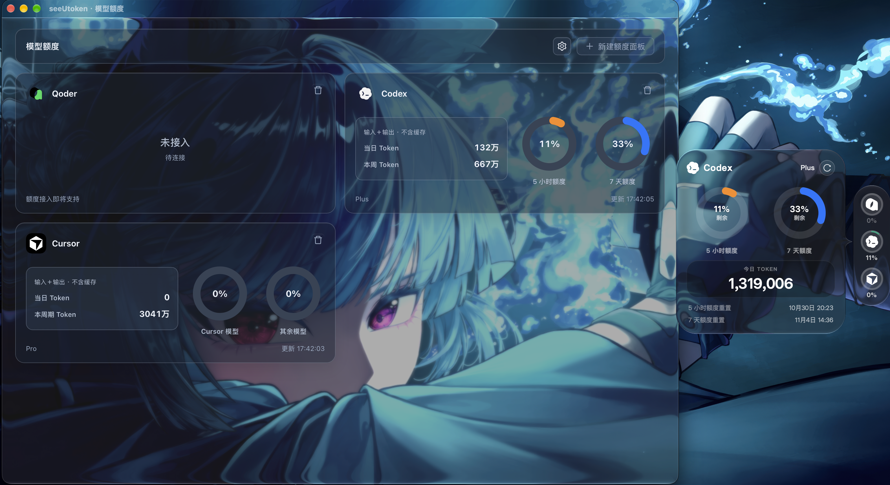

<div align="center">


# seeUtoken

**让 Cursor 与 Codex 的额度和 Token 用量，一眼可见。**

模型额度首页 · 用量详情大屏 · 桌面侧边栏 · 年度热力图 · Liquid Glass


[下载安装](#下载安装) · [功能特性](#功能特性) · [快速开始](#快速开始) · [数据来源与统计口径](#数据来源与统计口径) · [常见问题](#常见问题) · [反馈问题](https://github.com/Alver-Lin/seeUtoken/issues)

</div>



## 下载安装

当前下载安装版本为 **v1.0.1**，发布于 **2026 年 10 月 29 日**，适用于 macOS 与 Windows。

- **macOS 14+ / Apple Silicon**：[下载 seeUtoken-V1.0.1.dmg](https://github.com/Alver-Lin/seeUtoken/releases/download/v1.0.1/seeUtoken-V1.0.1.dmg) · [SHA-256 校验文件](https://github.com/Alver-Lin/seeUtoken/releases/download/v1.0.1/seeUtoken-V1.0.1.dmg.sha256)
- **Windows 10/11 x64**：[下载 seeUtoken-V1.0.1.exe](https://github.com/Alver-Lin/seeUtoken/releases/download/v1.0.1/seeUtoken-V1.0.1.exe) · [SHA-256 校验文件](https://github.com/Alver-Lin/seeUtoken/releases/download/v1.0.1/seeUtoken-V1.0.1.exe.sha256)

安装包已包含应用运行代码与前端，无需安装 Python 或 Node.js。Windows 运行环境与 macOS 首次打开方式见[快速开始](#快速开始)。

**v1.0.1 更新**：新增 Windows 单文件 EXE、系统托盘与侧边栏轮廓裁剪；新增白色标准和白色通透两种 Liquid Glass 外观；统一 macOS 与 Windows 的应用版本和打包说明。

[查看完整发布说明](https://github.com/Alver-Lin/seeUtoken/releases/tag/v1.0.1) · [浏览所有版本](https://github.com/Alver-Lin/seeUtoken/releases)

## seeUtoken 是什么？

seeUtoken 是一款桌面 AI 编程用量监控工具，把 Cursor 和 Codex 的账户额度、Token 消耗、模型分布和使用记录集中展示在一个应用里。

写代码时，用常驻侧边栏查看剩余额度；需要复盘时，打开详情大屏，查看每次提问的用量、年度活跃热力图和历史趋势。应用读取本机已有的登录状态与会话记录，结合提供方的账户接口获取数据，无需部署额外的服务端。

支持 **macOS 14+（Apple Silicon）**与 **Windows 10/11 x64**，分别提供 DMG/PKG 与 EXE 安装器的构建脚本。界面使用 Vue 3 + Ant Design Vue，桌面窗口由 Python + pywebview 驱动。

## 支持的工具

- **Cursor**：识别本机登录状态，读取账户额度、账期用量和使用记录；结合本机历史匹配用户提问与项目名称。
- **Codex**：通过本机 Codex 的 `app-server` 读取账户及额度窗口；从本机会话和归档记录中统计 Token、模型、项目与提问用量。

首页同时保留 **Qoder** 面板入口，目前尚未接入真实用量数据。每种工具只能添加一个额度面板，删除后可以重新添加。

## 功能特性

### 账户额度，一处查看

- **模型额度首页**：并列查看已添加工具的当日 Token、周期用量和剩余额度。
- **Cursor 账户额度**：展示订阅账期及接口返回的额度信息，点击卡片进入详情。
- **Codex 额度窗口**：展示各额度窗口的剩余比例、重置时间与倒计时。
- **独立刷新设置**：Cursor 与 Codex 分别保存刷新间隔，可选手动、1、5、15 或 30 分钟，也可随时点击「立即刷新」。
- **同步状态提示**：显示最近更新时间；Codex 同步失败时保留最近额度快照，已过期的窗口标记为待更新。

### 用量明细，看清每次消耗

- **Token 拆分**：查看输入、输出和缓存读写，支持切换是否将缓存计入主统计数字。
- **模型分布**：按时间范围查看不同模型的 Token 用量、调用次数和占比。
- **使用记录**：展示调用时间、模型、项目和对应的用户提问；长提问可悬停查看全文。
- **Codex 按提问汇总**：同一次提问中的多次模型调用合并为一条记录，回答进行中持续累计用量。
- **年度热力图与趋势**：按日期查看历史活跃情况和 Token 消耗变化。

### 桌面侧边栏，随手可见

- **常驻用量栏**：在桌面查看工具图标、用量和额度，点击展开对应信息。
- **macOS 贴边收起**：拖到屏幕左侧或右侧，移出后收为窄条；悬停展开，拖离边缘后保持展开。
- **可选始终置顶**：独立控制窗口置顶与贴边自动缩进，修改后立即生效并保存。
- **双击直达详情**：双击 Cursor 或 Codex 图标打开对应大屏，拖动侧边栏时不会误触发。
- **菜单栏与托盘控制**：打开主窗口、显示或隐藏侧边栏，以及退出应用。
- **Mac 图标**：Dock 与应用图标采用层叠纸艺风格，保留白色底板，圆角曲线及留白与本机系统图标对齐；顶部菜单栏使用透明单色模板，自动适配深浅色背景。

### 六种外观，统一切换

在首页设置中选择外观，模型额度首页、详情大屏、侧边栏与弹窗会同步更新：

- **白天模式**：浅色背景，适合明亮环境。
- **黑夜模式**：深色界面，适合夜间使用。
- **Liquid Glass（标准）**：带有玻璃质感的半透明外观。
- **Liquid Glass（通透）**：更通透的玻璃外观。
- **Liquid Glass（白色标准）**：白色原生玻璃，搭配深色文字与柔和磨砂。
- **Liquid Glass（白色通透）**：更轻透的白色原生玻璃，保留桌面背景与玻璃高光。

macOS 主窗口会按系统能力使用原生 Liquid Glass 或 Vibrancy 兼容效果，标题栏随外观切换。系统开启「降低透明度」时，应用改用不透明背景。

## 快速开始

### Windows EXE（V1.0.1）

1. 使用 Windows 10/11 64 位系统，确保已安装 [.NET Framework 4.8](https://dotnet.microsoft.com/download/dotnet-framework/net48) 与 [Microsoft Edge WebView2 Runtime](https://developer.microsoft.com/microsoft-edge/webview2/)。
2. [下载 seeUtoken-V1.0.1.exe](https://github.com/Alver-Lin/seeUtoken/releases/download/v1.0.1/seeUtoken-V1.0.1.exe)，双击运行，无需安装 Python 或 Node.js。
3. 确保本机 Cursor 或 Codex 已登录，在首页查看额度与 Token 用量。

Windows 版包含主页、两种工具详情、系统托盘、可拖动与置顶的侧边栏，以及六种外观。侧边栏按实际轮廓裁剪，不会用透明空白区域遮挡桌面。Windows 11 22H2 及以上的主窗口玻璃外观使用原生 Desktop Acrylic：标准模式遮罩更厚，通透模式保留更多背景色彩。异形侧边栏独立控制窗口透明度，标准模式不透明、通透模式为 80%，保留胶囊与弹窗的裁剪。旧版 Windows 或主窗口材质不可用时，主窗口使用不透明配色；系统关闭透明效果时，所有窗口均恢复不透明。macOS 原生 Liquid Glass 与贴边自动缩进仍为 macOS 专属。设置、缓存、WebView2 登录数据和诊断日志均保存在 `%APPDATA%\seeUtoken\`。重复打开 EXE 会提示已运行，可从托盘恢复主窗口。

Codex 默认识别 `PATH` 与 `%APPDATA%\npm` 中安装的原生程序或 npm 启动器，也可通过 `SEEU_CODEX_EXECUTABLE` 指定 `codex.exe` 的完整路径。Windows 与 WSL 是独立的数据环境；WSL 内部的登录与会话不会自动出现在 Windows 版本中。

### 安装 macOS DMG

可直接[下载 seeUtoken-V1.0.1.dmg](https://github.com/Alver-Lin/seeUtoken/releases/download/v1.0.1/seeUtoken-V1.0.1.dmg) 安装；自行构建见下方的[打包 macOS 应用](#打包-macos-应用)。

1. 确认设备使用 Apple Silicon 芯片，并运行 macOS 14 或更高版本。
2. 打开 DMG，将 `seeUtoken.app` 拖入 `Applications` 文件夹。
3. 在「应用程序」中打开 seeUtoken，无需额外安装 Python 或 Node.js。
4. 确保本机 Cursor 或 Codex 已登录，然后进入对应面板查看数据。

当前 DMG 使用本地 ad-hoc 签名，尚未进行 Developer ID 签名及 Apple 公证。首次打开若被系统拦截，请按[安装说明](packaging/macos/INSTALL.txt)操作。

### 覆盖升级（从 v1.0.2 安装器开始）

上方下载入口仍保留已发布的 **v1.0.1 历史安装包**。下面描述的是当前源码构建的新安装器，不会改变旧安装包本身的行为。

- **macOS**：打开新 DMG，双击「安装 seeUtoken.pkg」。安装器关闭旧版后，将 `/Applications/seeUtoken.app` 完整替换为新版；应用名和 Bundle ID 保持不变，也支持从拖拽安装的 v1.0.1 升级。同版本重新安装也会替换程序文件。从 v1.0.3 开始，还会移除系统与用户「应用程序」目录中同一 Bundle ID 的旧版副本，并在登录用户的会话中清理旧挂载、废纸篓和临时打包路径的重复图标记录；无人登录时在首次启动补做清理。
- **Windows**：双击新 EXE，按安装向导完成安装。程序固定保存在 `%LOCALAPPDATA%\Programs\seeUtoken\seeUtoken.exe`，后续版本复用同一安装记录和开始菜单快捷方式。安装前会关闭当前用户正在运行的已识别旧版，包括 v1.0.1 便携 EXE；若旧版无法退出，安装会停止，保留原有程序。
- **个人数据保留**：macOS 的 `~/.config/seeUtoken/` 和 Windows 的 `%APPDATA%\seeUtoken\` 均不会被升级或卸载清除。下载目录中的历史 DMG、EXE 安装文件及自行复制到其他目录的便携文件不会被扫描删除；从 v1.0.1 便携版迁移后，请使用开始菜单中的 seeUtoken。

### 从源码运行

准备 **Python 3.10+**；需要构建或修改前端时，还需安装 **Node.js 22+ 与 npm**。

```bash
git clone https://github.com/Alver-Lin/seeUtoken.git
cd seeUtoken

python3 -m venv .venv
source .venv/bin/activate
python -m pip install -r requirements.txt

cd frontend
npm ci
npm run build
cd ..

python run.py
```

仓库已包含 `ui/` 构建产物；只运行现有界面时，可跳过前端安装与构建步骤。也可以使用 `python -m seeutoken` 启动。

上述命令适用于 macOS。Windows 使用 `.venv\Scripts\activate` 激活虚拟环境，并需要 WebView2；Linux 的 WebView 运行环境需按 pywebview 要求另行准备。macOS 原生玻璃、贴边收起等功能依赖 AppKit，其他平台不提供相同的原生效果。

### 首次使用

1. **接入 Cursor**：先在本机 Cursor 中登录。若尚未识别到账户，可在 Cursor 详情页点击「登录 Cursor」，完成登录后刷新。
2. **接入 Codex**：在本机安装并登录 Codex。应用需要能找到 `codex` 可执行文件；macOS 也会尝试识别 `/Applications` 下应用内置的 Codex CLI。
3. **整理面板**：在模型额度首页添加或删除工具面板，点击卡片进入对应详情。
4. **调整偏好**：在首页设置中切换外观、缓存统计、侧边栏显示、贴边自动缩进和始终置顶。

首次启动默认使用白天模式，Token 统计不含缓存，显示侧边用量栏，并开启始终置顶；macOS 同时开启贴边自动缩进。后续启动会恢复已保存的偏好。

## 数据来源与统计口径

### Cursor

账户额度与用量通过 Cursor Dashboard 相关接口读取；本机登录状态来自 Cursor 的 `state.vscdb`：

- **macOS**：`~/Library/Application Support/Cursor/User/globalStorage/state.vscdb`
- **Windows**：`%APPDATA%\Cursor\User\globalStorage\state.vscdb`
- **Linux**：`~/.config/Cursor/User/globalStorage/state.vscdb`

使用记录中的提问按会话标识和调用时间匹配本机用户消息；项目名称结合 `~/.cursor/projects/` 下的目录信息解析。本机历史缺失时，相关字段显示「—」。

Cursor 默认每 **5 分钟**自动刷新一次。接口数据可能有延迟，且历史覆盖范围取决于提供方返回的数据。

### Codex

Codex 使用两种数据来源：

- **账户与额度**：通过本机 `codex app-server` 查询账户信息和额度窗口，默认每 **1 分钟**同步一次。
- **本机用量**：读取 `CODEX_HOME` 下的 `sessions/` 与 `archived_sessions/`，未设置时使用 `~/.codex/`；界面通常每 **15 秒**更新本机统计。

统计按累计计数的增量计算，避免重复额度快照与会话归档副本重复计数，并排除内部自动审核模型。使用记录按每次提问合并；缺少提问标识及开始标记的旧记录保留各次调用。模型分布和调用次数仍按原始模型调用计算。

**本机 Token 统计只覆盖这台设备保留的记录，不代表账户在所有设备上的云端账单。** 删除来源会话文件可能影响历史统计。

### Token 是否包含缓存？

设置中的「Token 统计口径」统一控制首页、侧边栏、模型分布、热力图与趋势图的主数字：

- **默认关闭**：不含缓存的输入 Token + 输出 Token。
- **开启包含缓存**：在默认口径上加上缓存读取与写入 Token。

详情始终保留输入、输出、缓存等拆分。切换统计口径只影响 Token 展示，不改变账户额度或账单。

<details>
<summary>查看不同数据来源的计算规则</summary>

- **Cursor**：`inputTokens` 与缓存字段分列；默认合计为 `inputTokens + outputTokens`，含缓存时再加 `cacheReadTokens + cacheWriteTokens`。
- **Codex**：`input_tokens` 已包含缓存输入；默认合计为 `input_tokens - cached_input_tokens - cache_write_input_tokens + output_tokens`，含缓存合计为 `input_tokens + output_tokens`。
- **推理 Token**：Codex 的输出已包含推理 Token，不额外重复累加。
- **时间范围**：「今日」按本机时区零点起算；Cursor 的「本周期」指订阅账期，Codex 的「本周」指本地时间周一至今，与账户滚动额度窗口分别统计。

</details>

## 本地数据与隐私

seeUtoken 在本机解析会话与项目元数据，当前实现不向项目维护者上传用量或提问内容。读取账户额度仍需连接对应提供方的服务。

详情页会显示匹配到的**用户提问原文**；Codex 提问会去除自动附带的附件清单与环境信息。详情记录不展示系统指令、助手回复、工具输出或登录凭据。分享界面截图时，请留意其中的提问和项目名称。

应用设置与 Cursor 用量缓存保存在：

- **macOS / Linux**：`~/.config/seeUtoken/`
- **Windows**：`%APPDATA%\seeUtoken\`

其中 `settings.json` 保存偏好及可能设置的手动登录 Token，`usage_cache.json` 保存最近的 Cursor 用量数据。请勿将这些个人数据文件提交到公开仓库。两平台的打包脚本均会清除页面中注入的本机启动数据，安装包不包含构建者的账户信息与个人设置。

## 常见问题

### 为什么 Codex 有剩余额度，却没有 Token 用量？

两者的数据来源不同。额度来自账户接口，本机 Token 来自会话日志；只有其他设备上的使用记录，或本机记录已删除时，二者可能不同。请检查 `CODEX_HOME` 是否指向实际使用的目录，并在本机 Codex 中完成一次使用后刷新。

### 为什么「会话内容」或「项目」显示为「—」？

Cursor 需要能够匹配到本机会话历史与项目目录，Codex 需要记录中包含相应元数据。缺少来源数据时，应用保留用量，并以「—」显示无法匹配的字段。

### 为什么 Codex 的剩余额度显示为未知或待更新？

账户接口尚未返回数据，或最近快照的额度窗口已过期。确认 Codex 已登录且网络可用，再点击「立即刷新」；手动刷新模式下，首次同步后需要主动刷新账户额度。

### 关闭窗口后，应用还会留在菜单栏吗？

在 macOS 和 Windows 上，关闭主窗口会完整退出应用，同时关闭侧边栏与托盘。需要暂时收起时，请最小化或隐藏主窗口，再通过系统托盘或 macOS Dock 恢复窗口。

### 为什么 Liquid Glass 的效果与其他 Mac 不同？

效果取决于 macOS 版本、原生材质支持和辅助功能设置。较旧系统会回退到 Vibrancy；开启「降低透明度」时会使用不透明背景。

## 开发与构建

`main` 是 macOS 与 Windows 共用的稳定分支，`dev` 是日常开发分支。两端通过平台判断使用各自的原生实现，从同一代码库分别构建 DMG 和 EXE。功能在 `dev` 完成验证后合入 `main`，再创建版本标签发布。

### 目录结构

```text
seeUtoken/
├── seeutoken/          # Python 后端：账户接入、用量统计、桌面窗口与原生材质
├── frontend/          # Vue 3 + Ant Design Vue 源码
├── ui/                # 前端构建产物，供桌面应用加载
├── assets/            # 应用与托盘图标
├── packaging/         # macOS DMG 与 Windows EXE 打包脚本
├── .github/workflows/ # Windows 自动构建与打包后启动检查
├── tests/             # Python 回归测试
├── run.py             # 启动入口
└── requirements.txt   # Python 运行依赖
```

### 前端开发

在 `frontend/` 目录执行 `npm run dev` 可单独预览页面。修改完成后执行 `npm run build`，将界面更新到 `ui/`，再启动桌面应用验证原生交互。

### 运行测试

在项目根目录、已安装依赖并激活虚拟环境后执行：

```bash
python -m unittest discover -s tests
node --test frontend/src/pages/float/popupPlacement.test.js frontend/src/pages/float/railDrag.test.js
```

需要 macOS 窗口服务的原生交互测试默认跳过，可在本机使用 `SEEUTOKEN_NATIVE_TESTS=1` 显式启用。

### 打包 macOS 应用

在 Apple Silicon Mac 上准备好 `.venv`、Python 运行依赖和前端依赖后执行：

```bash
bash packaging/macos/build.sh
```

脚本会构建前端、准备资源、使用 PyInstaller 打包应用，并生成：

- `dist/seeUtoken-V1.0.3.pkg`
- `dist/seeUtoken-V1.0.3.dmg`（内含 PKG 安装器）
- `dist/seeUtoken-V1.0.3.dmg.sha256`

构建过程中的 `.app` 放在临时构建目录，打包结束后自动注销并回收，避免开发目录中的副本出现在应用搜索中。

默认使用 `.venv/bin/python` 与系统 `node`，可通过 `SEEU_BUILD_PYTHON` 和 `SEEU_BUILD_NODE` 指定工具路径。当前目标为 **arm64 / macOS 14+**，不提供 Intel Mac 安装包。

### 打包 Windows EXE

在 Windows x64 上安装 **Python 3.12 x64（带 py 启动器）**、**Node.js 22+** 和 [Inno Setup 6](https://jrsoftware.org/isdl.php)，从项目根目录执行：

```powershell
powershell -ExecutionPolicy Bypass -File packaging/windows/build.ps1
```

脚本在项目的 `.venv-windows` 中安装依赖，运行测试、构建前端、生成多尺寸 ICO 图标，再将无控制台应用封装为支持覆盖升级的安装器：

- `dist/seeUtoken-V1.0.3.exe`
- `dist/seeUtoken-V1.0.3.exe.sha256`

打包只包含应用资源，自动剔除页面内的本机账户、用量与设置快照。EXE 的文件版本和产品版本为 **1.0.3**；当前构建未做 Windows 代码签名。

两端安装器与应用版本统一读取 `seeutoken/__init__.py`。Windows 的应用载荷保存在 `build/windows/app/seeUtoken.exe`，分发时应使用 `dist/` 中的安装器。

也可以运行 GitHub Actions 中的 **Build Windows EXE** 与 **Build macOS installer** 工作流。除 Windows WebView2 启动检查外，两端均在临时运行器上执行真实安装升级测试，验证运行中的 v1.0.1 被替换、同版本重装和个人数据保留。PyInstaller 需要目标操作系统，不能直接在 macOS 上交叉生成 Windows EXE。

## 参与贡献

欢迎通过 [Issues](https://github.com/Alver-Lin/seeUtoken/issues) 反馈问题，或提交 Pull Request 改进功能。报告问题时请附上系统版本、启动方式、涉及的工具及复现步骤，并去除登录 Token 与私密会话内容。

## 致谢

- [Token Monitor](https://github.com/Javis603/token-monitor/blob/main/README.zh-CN.md)：本 README 的内容组织与展示方式参考。
- [pywebview](https://github.com/r0x0r/pywebview)、[Vue](https://github.com/vuejs/core) 与 [Ant Design Vue](https://github.com/vueComponent/ant-design-vue)：桌面窗口与界面基础。

seeUtoken 是独立的非官方项目，与 Cursor、OpenAI 或其他工具提供方无隶属关系。
